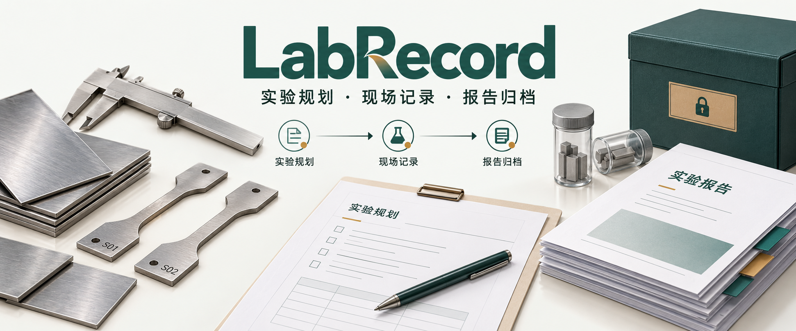
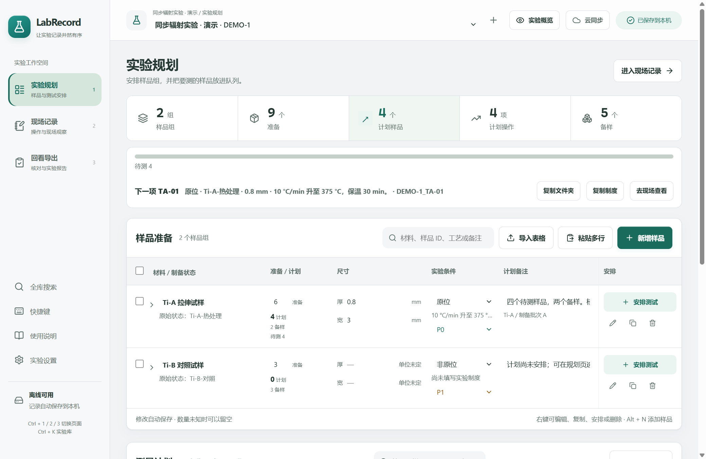
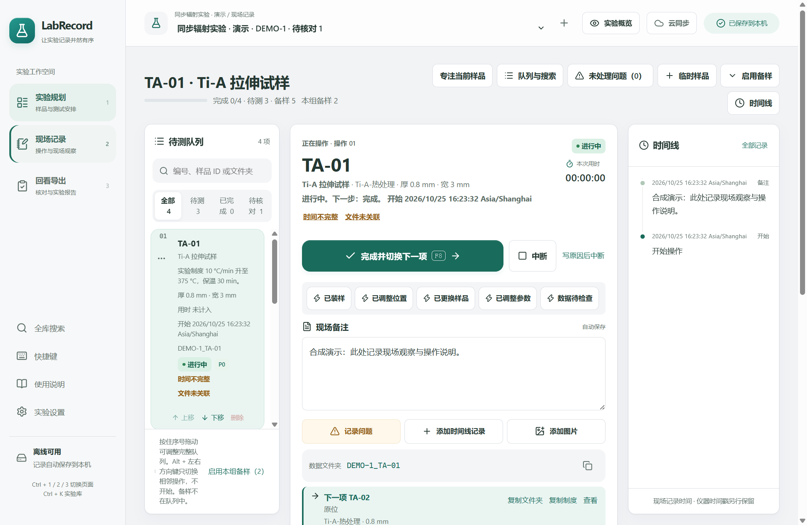
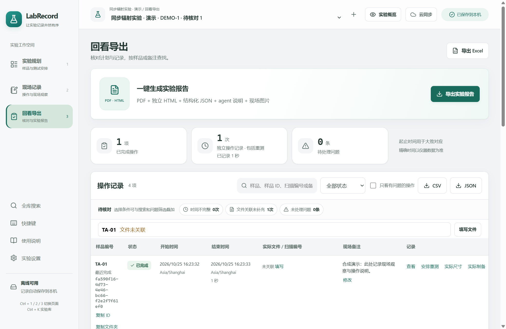
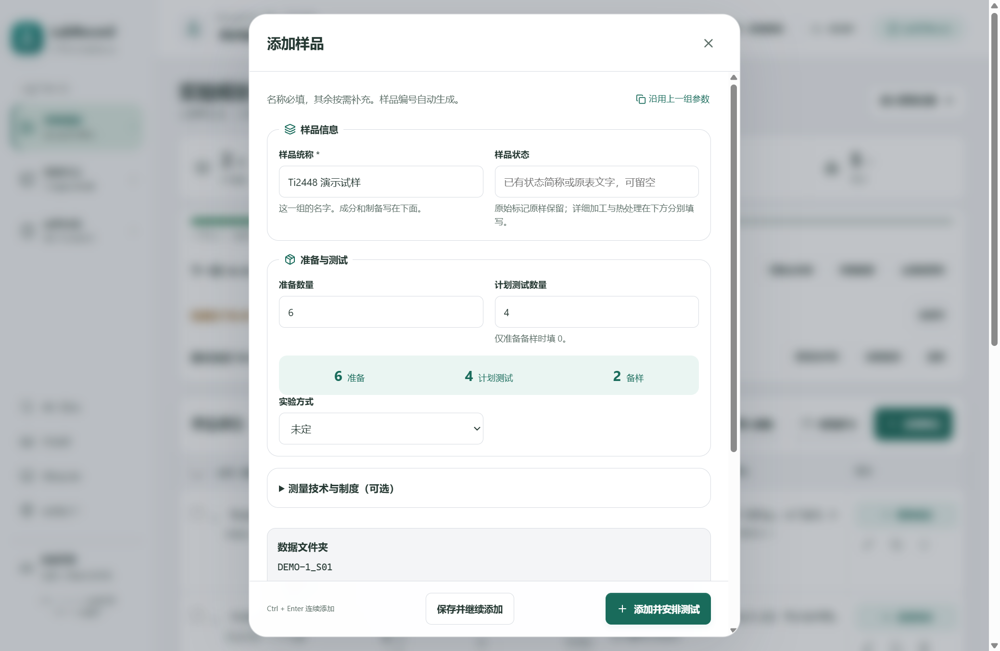

<p align="center">
  <a href="https://github.com/D-sudoasd/LabRecord/releases/latest">
    
  </a>
</p>

<p align="center"><em>imagegen 概念主视觉。实际软件界面见下方的真实截图。</em></p>

<h1 align="center">LabRecord</h1>

<p align="center"><strong>规划样品、记录现场操作，一次导出可追溯的实验报告。</strong></p>

<p align="center">
  <a href="https://github.com/D-sudoasd/LabRecord/releases/download/v0.8.1/LabRecord-0.8.1-Windows-x64.zip"><strong>下载 Windows 版 · 0.8.1</strong></a>
  &nbsp;·&nbsp; <a href="#三步完成一次实验">三步开始使用</a>
  &nbsp;·&nbsp; <a href="docs/beamtime-workflow.md">现场使用流程</a>
  &nbsp;·&nbsp; <a href="CHANGELOG.md">更新记录</a>
</p>

<p align="center">
  
  <a href="LICENSE"></a>
  
</p>

> 中文 Windows 桌面应用。实验规划、现场记录和报告导出可以离线完成；需要换电脑时，再连接各自的 GitHub 私人数据仓库。

## 从规划到报告

一件实物样品可以安排不同测量制度或条件，后续重测沿用样品编号并关联原记录。现场记录保存操作时间、备注、问题和照片；结束后可回看缺项，并把整份实验记录导出。

### 实验规划



同一件样品可安排循环加载、分级加载、旋转扫描或离位测量。准备数量、不同待测样品数和计划操作数分别统计；启用备样后才加入计划。未知时间与未填数量不补成零，单位按录入保留。

### 现场记录



专注模式下，当前编号与主要操作在滚动时仍可见。用“开始操作”“完成”记下操作起止时间，用快记、备注、问题和图片保留现场信息；查看下一件只选中样品，不会替你开始操作。记录保存到本机，也可离线使用。

### 回看与导出



核对待补时间、未关联文件和未处理问题。报告一次包含：

- PDF：便于阅读和打印。
- 独立 HTML：含图片，可离线打开。
- `records.json`：完整记录、稳定 ID、空值、单位和修改历史。
- 图片、`README-agent.md` 和 SHA-256 校验清单。



只需填写样品统称即可安排操作；数量和尺寸可按需补充。修改过的样品表单若被关闭，会先给出“继续填写”或“放弃填写”选择。

## 三步完成一次实验

1. **下载并打开。** 下载上方的 Windows x64 ZIP，完整解压后双击 `LabRecord.exe`。不需要安装 Node.js、Python、Excel 或数据库。首次打开可选择载入演示实验；演示记录会保存在本机实验库。
2. **建立实验并记录。** 点击“新建第一个实验”，填写实验名称，软件会建议一个当天尚未使用的编号。到“实验规划”添加样品，检查准备数量和测试数量；在“现场记录”选中样品并点击“开始操作”。
3. **核对并导出。** 在“回看导出”补充已知的时间或文件信息，再点“导出实验报告”。未知信息可以留空，软件不会替你补时间或推断科学结论。

**常用快捷键：** `Alt+N` 打开快速添加，`Ctrl+Enter` 保存并继续，`Ctrl+K` 打开实验库，`Ctrl+1 / 2 / 3` 切换页面；现场页的 `F8` 开始或完成当前操作。输入、中文输入法组合输入和弹窗期间不会触发 `F8`。

Windows 程序目前尚未代码签名。

0.8.0 可以随时回到开始页，并直接打开已有实验。自定义参数可以调整填写顺序。0.7.1 起会自动建议当天未使用的实验编号；重复编号在保存前提示。添加样品时，关闭弹窗或按 `Escape` 可先继续填写或明确放弃；清除全库搜索会回到实验列表，并保留键盘焦点。数据库与备份格式继续使用 v1。下面的规划、现场和回看截图来自 0.7.1。

## 适合实验室工作流的细节

- **多种制度、同一样品。** 测量制度各自保存；重测增加操作并关联原记录，不另造物理样品。
- **实际值有来历。** 操作开始时保存计划快照；之后更正样品信息不会改写开始时的计划或原始自动时间。
- **报告有边界。** 报告整理已保存的记录，不判定实验数据是否合格，也不代替仪器数据分析。
- **仪器原始数据由你管理。** 软件保留填写的文件名和路径引用；这不代表仪器原始文件已上传。换电脑时请单独复制文件并核对路径。
- **记录保存在本机。** 可生成完整备份并从备份恢复。使用云同步时，两台电脑各自登录；互有修改时软件提示选择版本，并先备份本机数据。

## 连接你自己的私人仓库

每位使用者使用**自己的 GitHub 私人仓库**，其中保存完整备份和独立报告版本。公开的 LabRecord 源码不包含实验记录，也不会授予他人访问私人仓库的权限。

1. 在 GitHub 创建并初始化一个私人仓库，在应用的“云同步”页填写仓库地址。
2. 使用本机已登录的 GitHub CLI，或仅向该仓库授予 **Contents 读写**权限的细粒度令牌。令牌由 Windows 加密保存在本机。
3. 手动点击“同步实验记录”，在另一台电脑连接同一仓库后即可接续。

报告先保存到本机，已连接私人库时可在后台自动归档；联网失败会保留本地报告和待上传任务。单独归档或下载时，应用会校验报告文件和 SHA-256。请保留完整报告目录，先读其中的 `README-agent.md` 再分析。

## 更多说明

- [完整离线使用说明](docs/使用说明.html) · [报告私人归档](docs/private-storage.md) · [同步辐射现场流程](docs/beamtime-workflow.md)
- [数据模型和实现边界](docs/architecture.md) · [更新记录](CHANGELOG.md) · [0.7.1 验证与校验值](docs/verification-0.7.1.md) · [截图来源与版本](docs/images/sources.json)
- [主视觉生成提示词与来源](assets/readme/hero-0.7.1.md) · [MIT License](LICENSE)

## 开发

需要 Node.js 24。下载 ZIP 的最终用户无需安装开发环境。

```powershell
npm ci
npm run dev
npm run verify
npm run dist
npm run test:packaged
node scripts/check-release.mjs
```

界面截图及桌面验收使用合成实验和独立临时目录，不写入真实实验数据库。测试和打包流程见[验证记录](docs/verification-0.7.1.md)。

[下载 LabRecord 0.7.1](https://github.com/D-sudoasd/LabRecord/releases/tag/v0.7.1) · [查看本版更新说明](docs/releases/v0.7.1.md)
