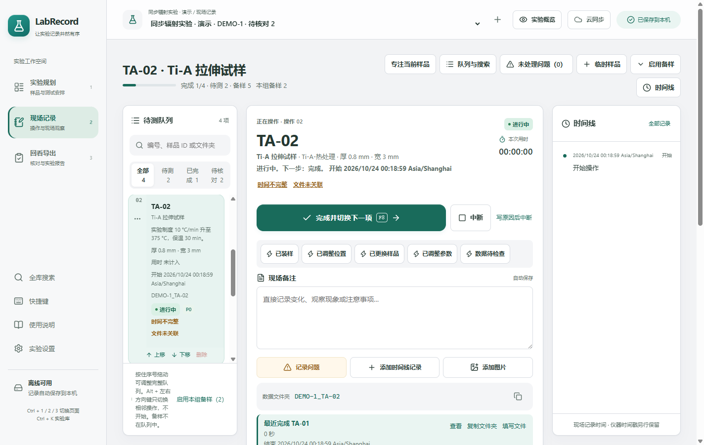

# 2026-10-24 易用性改进验证

本轮由 6 个 Astra / xhigh 子代理分工完成规划、现场、回看、导航、验收和说明更新，主代理整合并运行桌面及打包验证。基于本地提交 `15d3d39d3092185cd6a7b68f8c4875a58036d7c6`，版本保持 0.7.0；这是本地交付，未发布到 GitHub。

## 使用变化

| 场景       | 改动前                                     | 改动后                                                      |
| ---------- | ------------------------------------------ | ----------------------------------------------------------- |
| 新增样品   | 四项材料制备输入始终展开                   | 空白时收起；已填参数自动展开并标明已填写                    |
| 安排测试   | 普通安排需要填写数量                       | 默认 1 件；剩余数量明确且合适时可一键全部安排，确认后才写入 |
| 现场记录   | 上下文提示在快记和备注之前；文件夹复制靠后 | 主按钮后依次是快记、备注、记录入口和当前文件夹              |
| 现场队列   | 序号、菜单和优先级共同挤占正文             | 序号与菜单共用左列；优先级随状态显示，选中时编号可见        |
| 回看核对   | 从清单跳现场或在表格查找编辑入口           | 清单直接打开原有时间、文件弹窗；小窗口仍能看到表格首行      |
| 测量筛选   | 需要逐项取消组合条件                       | 一次清空搜索、状态、差异条件和勾选                          |
| 全库搜索   | 只显示前 8 项，打开后输入未获焦            | 直接输入，显示总数、按需追加结果，一键清空回实验库          |
| 第一次使用 | 版本细节和长段规则占用阅读空间             | 前置完整三步流程，低频规则按需展开                          |

没有增加设置项、依赖、主进程接口或数据格式。准备数量、不同样品、计划操作、备样、开始时快照及原始时间继续使用原有规则。上述差异是可复现的交互变化，没有进行用户耗时实验，也未宣称测得完成任务速度提升。

## 验证结果

- 类型检查与生产构建通过。
- 116 项单元测试通过。此后修改集中在界面；单元测试覆盖的持久化、计算、搜索和共享模块未修改，沿用该次结果。
- 桌面共 142 个场景全部完成验证。完整首轮 135 项通过；6 项因新增清空按钮使旧模糊定位命中两个控件，改为精确搜索框定位后全部重跑通过。另 1 项发现回看清单挤高了窄窗布局，缩小文本入口的布局基准宽度后，原断言及新增补录场景均通过。没有跳过场景或放宽行为断言。
- Windows 打包程序完整一轮 **142 / 142 通过**，无失败、跳过或重试通过。包括独立临时目录中的导入导出、保存失败、关闭与重启、快记、重测、备份恢复、快捷键及窄窗操作。
- 新增 5 个场景覆盖材料折叠与沿用、默认和全部安排、筛选复位与回看补录、现场优先顺序和复制失败、搜索焦点和更多结果。初次检查发现的真实搜索焦点问题已修复。
- 实际 1424 像素宽视口中，队列正文为 137 像素，当前编号为单行；900 × 700 请求窗口、150% 缩放下通过搜索输入、清空、更多结果、现场换行及回看表格检查。
- 离线帮助在 Headless Edge 的 900 × 700 和 390 × 844 视口下无页面横向溢出，导航锚点有效，折叠段支持 Enter 开关。
- ZIP CRC 校验通过；149 个归档文件中，程序、app.asar、帮助、示例表及运行资源等 10 个关键文件与实际验收目录的 SHA-256 一致。

## 交付与证据

- 软件包：`release/LabRecord-0.7.0-Windows-x64.zip`（163095301 字节）。完整解压后运行 LabRecord.exe。
- SHA-256：`a1c1ff80c67ec2ba746f368aa3a08bd521f54d87ebe21337c8c9ae1a272083e1`。
- 机器可读记录：[verification-usability-20261024.json](verification-usability-20261024.json)；包含源码摘要、运行版本、测试统计及截图来源。
- 首轮与定向重跑证据：`local_artifacts/usability-20261023`；打包检查输出：`test-results`；交付清单：`release/delivery-manifest.json`。
- 原软件目录、测试结果和旧交付清单保留在 `local_artifacts/usability-20261023/previous-delivery`，以前的 ZIP 包继续保留。

本轮没有操作真实私人仓库，云同步及报告归档使用原有隔离测试。自动验收中的原生文件对话框使用临时路径，未向用户实验资料库写入验收数据。本轮验证软件操作与记录完整性，不代表真实仪器数据或科研结论验收。
